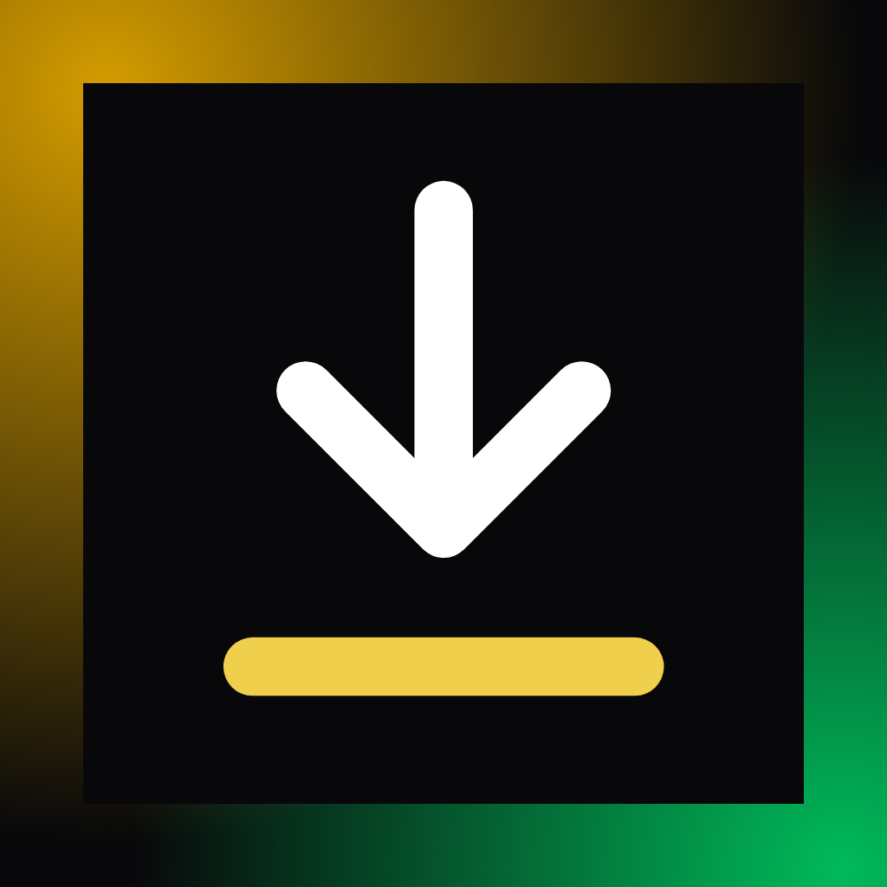

<p align="center">
  
</p>

# LightScrapVidz Mobile

Download videos from TikTok, Instagram, YouTube, Facebook — and any site supported by yt-dlp —
straight to your phone, as MP4 or MP3.

 

---

## Features

- **Single video or full playlist/profile** download
- **Audio-only extraction** to MP3
- **Quality selector** — best, 1080p, 720p, 480p
- **Live progress** streamed over WebSocket
- **Download queue** for batch processing
- **Local history** kept on the device
- **Completion notifications**
- **Videos saved to the photo library**; audio and other files shared through the system sheet

---

## Install

The mobile app is a thin client: the download work runs on a small server you host. Install the
server with one command, identical on macOS and Linux:

```bash
curl -fsSL https://raw.githubusercontent.com/light-scrap-vidz/light-scrap-vidz-mobile/main/install.sh | bash
```

| Platform | What it installs |
|----------|------------------|
| macOS (Apple Silicon) | `light-scrap-vidz-server` in `~/.local/bin`, plus `yt-dlp` and `ffmpeg` via Homebrew |
| Linux (x86_64) | `light-scrap-vidz-server` in `~/.local/bin`, plus `yt-dlp` and `ffmpeg` via your package manager |

Re-run the exact same command to upgrade to the latest release.

Then start it:

```bash
AUTH_TOKEN=choose-a-long-secret ~/.local/bin/light-scrap-vidz-server     # listens on 0.0.0.0:8787
```

**Android** — download `light-scrap-vidz.apk` from the
[latest release](https://github.com/light-scrap-vidz/light-scrap-vidz-mobile/releases/latest) and
open it on your device (allow installs from unknown sources).

**iOS** — App Store distribution is not viable for a video downloader (App Store policy). Use a
development build, ad-hoc/TestFlight, or personal signing — see [Development](#development).

On first launch, open **⚙ Settings** in the app and enter your server address, for example
`http://192.168.1.20:8787`, and the same **token** as the server's `AUTH_TOKEN`. The phone and the server must be able to reach each other — same
Wi-Fi/LAN, or a public/tunnelled URL. Use **Test connection** to verify.

> Prefer the desktop app? [light-scrap-vidz](https://github.com/light-scrap-vidz/light-scrap-vidz)
> runs everything locally, with no server to host.

---

## Requirements

- **Server:** macOS on Apple Silicon, or Linux x86_64. `yt-dlp` and `ffmpeg` must be on the `PATH` —
  the one-line installer sets them up for you. Override the binary location with `YTDLP_PATH`.
- **App:** Android 8+, or iOS via a development build.

---

## How it works

`yt-dlp` is a Python binary. It **cannot run inside an iOS app** — Apple's sandbox forbids spawning
arbitrary processes, and the App Store bans video-downloader apps. To get the *same* experience on
both iOS and Android, the heavy lifting runs on a server you host; the app is a thin client.

```
┌──────────────────────────┐        HTTP / WebSocket        ┌──────────────────────────┐
│  Mobile app (Expo / RN)  │  ───────────────────────────▶  │  Server (Rust + axum)    │
│  iOS + Android           │   URL, quality, audio, count   │  runs yt-dlp, streams    │
│                          │ ◀───────────────────────────   │  progress, serves files  │
│  saves to Photos / Files │    progress + file download    │                          │
└──────────────────────────┘                                └──────────────────────────┘
```

The server reuses the desktop app's `yt-dlp` command-building and progress-parsing logic
(`builder.rs`, `parser.rs`, `finder.rs`) almost verbatim.

### Server configuration

| Var | Default | Purpose |
|--------------|----------------------------|------------------------------------------|
| `PORT` | `8787` | Listen port |
| `OUTPUT_DIR` | system temp `/light-scrap-vidz` | Where downloads are stored (per-job folder) |
| `YTDLP_PATH` | auto-detected | Explicit path to the `yt-dlp` binary |
| `AUTH_TOKEN` | random, printed at start-up | Secret every request must present (`Authorization: Bearer …`) |
| `MAX_JOBS` | `4` | Downloads allowed to run at the same time |
| `RETENTION_HOURS` | `24` | Finished downloads are deleted after this long |

### Server API

| Method | Route | Purpose |
|--------|--------------------------------|-------------------------------------------|
| GET | `/api/health` | Liveness check (used by the app's Settings) |
| GET | `/api/info?url=` | Single-video metadata |
| GET | `/api/playlist?url=` | Playlist / profile metadata |
| POST | `/api/download` | Start a download → `{ download_id }` |
| GET | `/api/download/:id/ws` | WebSocket: `progress` / `complete` / `error` |
| POST | `/api/download/:id/cancel` | Cancel a running download |
| GET | `/api/download/:id/files` | List produced files |
| GET | `/files/:id/:name` | Download a produced file |

> **Auth / private content:** browser-cookie auth (the desktop feature) does not exist on mobile.
> If you need it, configure cookies **on the server** — pass a server-side browser name via the
> `cookies` query/body field, or extend the server to use `--cookies <file>`.

> **Security:** the server refuses every request without the token, only accepts `http(s)` links
> and a fixed list of browsers for cookies, and deletes finished downloads after `RETENTION_HOURS`.
> Use HTTPS (a reverse proxy or tunnel) if it is reachable from the internet: the token travels in
> every request.

---

## Uninstall

**Server — macOS and Linux**

```bash
rm ~/.local/bin/light-scrap-vidz-server
```

To also remove the downloads it kept:

```bash
rm -rf "${TMPDIR:-/tmp}/light-scrap-vidz"
```

**Android**

Uninstall **light-scrap-vidz** from your device's application settings.

---

## Development

```
light-scrap-vidz-mobile/
├── server/   Rust (axum) — runs yt-dlp, HTTP + WebSocket API
└── app/      Expo / React Native (TypeScript) — the mobile client
```

### Server

Requirements: Rust (stable), plus `yt-dlp` and `ffmpeg` on the `PATH` (or set `YTDLP_PATH`).

```bash
cd server
cargo run --release        # listens on 0.0.0.0:8787 by default
```

### App

Requirements: Node 22+, the Expo tooling, and either a physical device with **Expo Go** or a
simulator/emulator.

```bash
cd app
npm install
npx expo install --fix     # reconcile native module versions to the SDK
npx expo start             # then press i (iOS) / a (Android), or scan the QR
```

You can bake a default server address into `app.json` → `expo.extra.defaultServerUrl`.

### Building installables

```bash
npm install -g eas-cli
eas build --platform android      # APK / AAB
eas build --platform ios          # requires an Apple Developer account
```

### Linting & tests

| Where | Command | What it does |
|-----------|--------------------------------------|----------------------------------------------|
| `app/` | `npm run lint` | ESLint (TypeScript + react-hooks) |
| `app/` | `npm run typecheck` | TypeScript typecheck (`tsc --noEmit`) |
| `app/` | `npm test` | Jest unit tests (lib helpers) |
| `app/` | `npm run format` | Prettier (write) |
| `server/` | `cargo fmt --check` | rustfmt check |
| `server/` | `cargo clippy --all-targets -- -D warnings` | Clippy (warnings are errors) |
| `server/` | `cargo test` | Unit + HTTP integration tests |

---

## Changelog

[CHANGELOG.md](CHANGELOG.md) (English) and [CHANGELOG.fr.md](CHANGELOG.fr.md) (French) list the changes of every version and follow [Keep a Changelog](https://keepachangelog.com/en/1.1.0/). Keep both in step.

---

## License

MIT — see [LICENSE](LICENSE).
